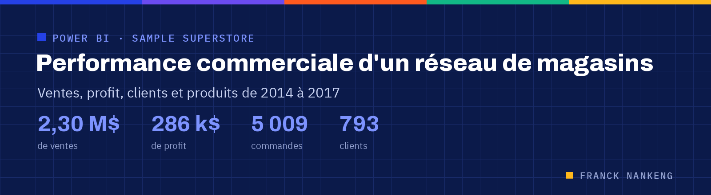
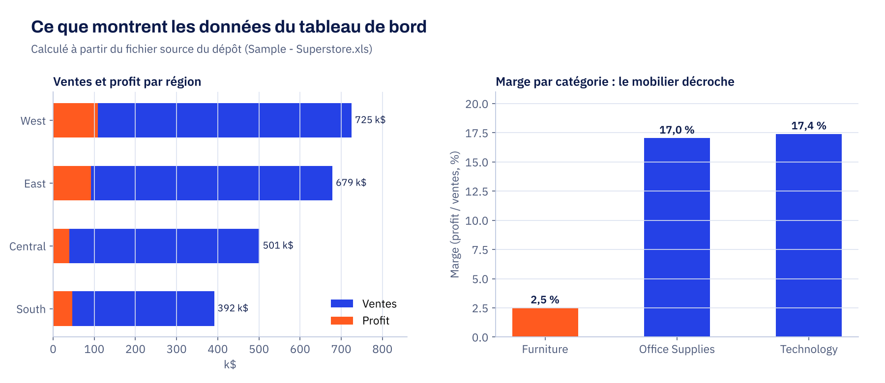

  
  
  
  

# Performance commerciale d'un réseau de magasins · Power BI

**Franck Nankeng** · [LinkedIn](https://www.linkedin.com/in/franck-nankeng-51b43b297/)

Tableau de bord Power BI qui analyse les ventes d'un réseau de magasins sur une période donnée, à partir du jeu de données
de référence *Sample – Superstore* (commandes, clients, produits, régions, ventes, remises et profit).

Aperçu calculé à partir du fichier source du dépôt

## Questions traitées
- Quelles régions portent le chiffre d'affaires et le profit ?
- Quel est le poids des remises sur la rentabilité ?
- Quels clients et quelles catégories de produits contribuent le plus ?

## Ce que j'ai réalisé
- Import et préparation du fichier Excel source dans Power Query.
- Page « Analyse régionale de la performance » : indicateurs clés en cartes, navigation illustrée par thème
  (clients, produits, expédition, profit, capital).

## Contenu
Tout se trouve dans le dossier `Creation-de-dashboard-pour-analyse-des-performances-de-ventes-des-magasins-master/`.

| Fichier | Rôle |
|---|---|
| `Performance global des magasins.pbix` | Rapport Power BI |
| `Sample - Superstore.xls` | Données sources |
| `Image/` | Visuels utilisés dans le rapport |

## Ouvrir le rapport
Ouvrir le fichier `.pbix` avec [Power BI Desktop](https://powerbi.microsoft.com/desktop/) et, si besoin, mettre à jour
le chemin du fichier `Sample - Superstore.xls`.

---
*English — Power BI sales performance dashboard built on the Sample Superstore dataset: regional KPIs, discount impact and customer/product contribution.*

---

### Autres projets

| [**Groupe Orvane**](https://github.com/Nganou1/orvane-powerbi) | [**Horizon_Contrat**](https://github.com/Nganou1/horizon-contrat-excel) | [**Process mining achats**](https://github.com/Nganou1/process-mining-achats) | [**Projets IA & ML**](https://github.com/Nganou1/projets-ia) |
|---|---|---|---|
| Power BI · 143 mesures DAX · RLS | Excel expert · Power Pivot · VBA | Python · PM4Py · audit SI | Python · machine learning · deep learning |

[Tous mes dépôts](https://github.com/Nganou1?tab=repositories) · [LinkedIn](https://www.linkedin.com/in/franck-nankeng-51b43b297/)
